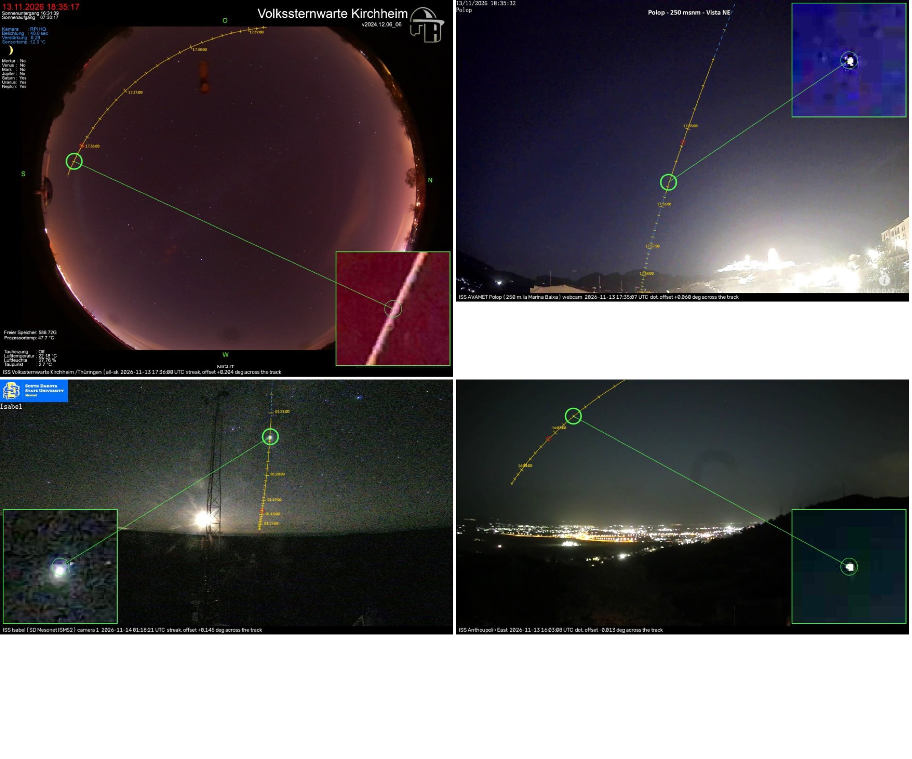
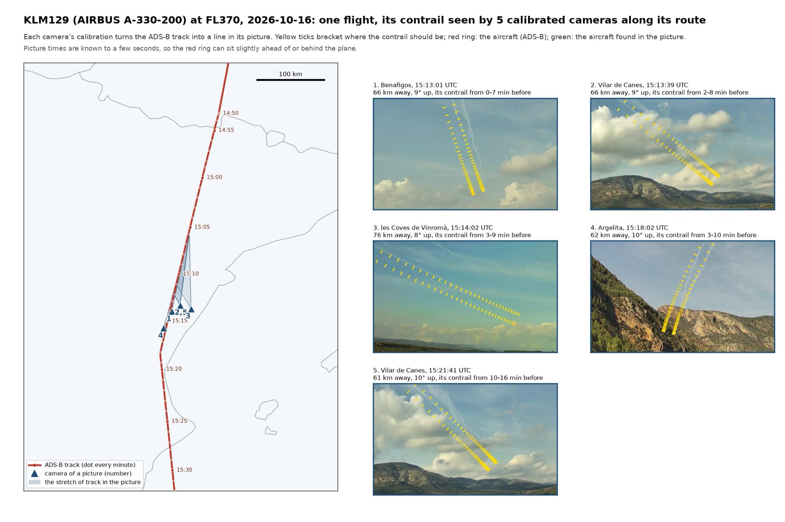

# Aircraft, contrails and the ISS in calibrated webcams

A best-of from the worldscope webcam network (October–November 2026). Each camera has a published calibration. The camera model and a known position (ADS-B for aircraft, the orbit for the ISS) predict where the object must be in the picture. These pictures show how close the prediction lands.

Robert Pless, George Washington University. Shared for discussion; please do not redistribute the pictures.

## The ISS in calibrated webcams

The ISS in three webcams: a Chicago tourist stream, a Valencia weather station and a San Diego wildfire camera. The dot lies 0.001° to 0.017° from the track that the orbit and the camera model predict. Over all cameras: 126 sightings in 92 cameras, a median of 0.06° from the predicted track.

ISS sightings on the evening of 14 November 2026.

## One aircraft in six cameras

ANA6 (Boeing 787-9) at 39,000 feet over northern California, 24 October 2026. Red ring: where ADS-B and the camera model put the aircraft. Yellow ticks: the contrail that the aircraft's track and the forecast wind predict.

## One flight and its contrail along the US East Coast

DAL75, 1 November 2026, Maryland to Virginia.

The longest contrail with the model on the aircraft: DAL75 seen from Windsor Mill, Maryland, 1 November 2026.

## Europe and the Pacific

AFR132 near Castellón, Spain, 16 October 2026.

KLM129, 16 October 2026.

JAL66, 25 October 2026.
